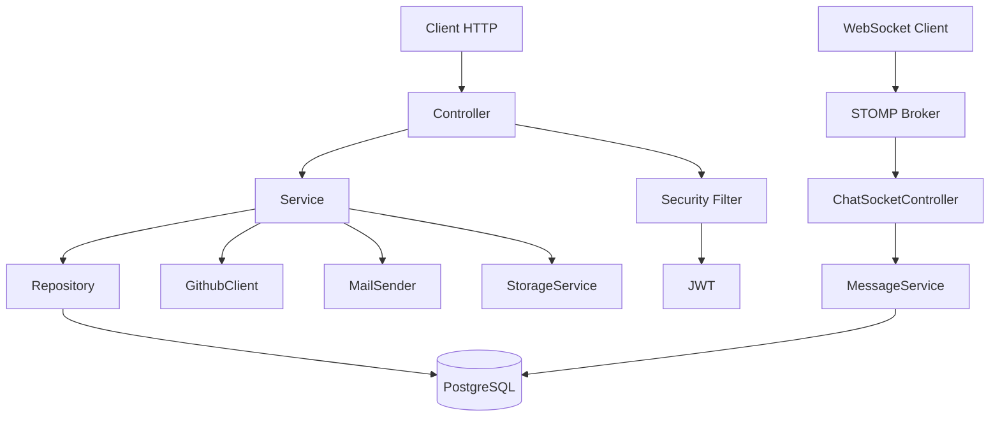

# Architecture backend

## Vue d’ensemble

Le backend Ndadiée est une application Spring Boot 4.1.1 destinée à une API REST sécurisée, avec des points d’entrée REST, un système d’authentification JWT, des services métier, des entités JPA et des intégrations externes. La configuration globale est visible dans [backend/pom.xml](../../backend/pom.xml) et [backend/src/main/resources/application.yaml](../../backend/src/main/resources/application.yaml).

Le projet est structuré par domaines fonctionnels plutôt que par couches purement techniques. On trouve ainsi des packages de type `authentication`, `controller`, `service`, `model`, `repository`, `security`, `storage`, `mail`, `github`, `config`, `event` et `initializer`.

## Organisation des packages

- `authentication/` : endpoints d’inscription, connexion, refresh token et informations utilisateur courante.
- `controller/` : API HTTP exposée, souvent classée par domaine métier (project, review, chat, admin, forum, etc.).
- `service/` : logique métier et orchestration des cas d’usage.
- `repository/` : accès JPA / query methods / specifications.
- `model/` : entités JPA, enums, objets métier et structures de données.
- `dto/` : requêtes et réponses échangées avec l’API.
- `security/` : JWT, filtres, CORS, permissions, interception STOMP.
- `exception/` : gestion uniforme des erreurs applicatives.
- `storage/` : abstraction de stockage disque/R2, routage des fichiers publics.
- `mail/` : API d’envoi SMTP pour notifications.
- `github/` : client REST/GraphQL GitHub et synchronisation des pull requests.
- `config/` : WebSocket, MVC, planification, etc.

## Couches applicatives

### 1. Couche de transport

Les contrôleurs exposent l’API REST avec Spring MVC. Les exemples les plus explicites sont [backend/src/main/java/com/hautetech/ndadiee/authentication/AuthenticationController.java](../../backend/src/main/java/com/hautetech/ndadiee/authentication/AuthenticationController.java) et [backend/src/main/java/com/hautetech/ndadiee/controller/ProjectController.java](../../backend/src/main/java/com/hautetech/ndadiee/controller/ProjectController.java).

Les contrôleurs héritent de [backend/src/main/java/com/hautetech/ndadiee/controller/BaseController.java](../../backend/src/main/java/com/hautetech/ndadiee/controller/BaseController.java), qui extrait l’identifiant du membre connecté depuis le `SecurityContext` et lève une `UnauthorizedException` si aucun utilisateur n’est authentifié.

### 2. Couche métier

Les services regroupent la logique de validation, d’orchestration et de contrôle d’accès. Par exemple, les services pour les projets, les messages, le forum et les revues sont dépendants du contexte utilisateur et appelent des repositories ainsi que des services spécialisés.

### 3. Couche persistance

Les repositories héritent du mécanisme Spring Data JPA. La persistance est pilotée par les entités du package `model`, dont la base commune est [backend/src/main/java/com/hautetech/ndadiee/common/BaseEntity.java](../../backend/src/main/java/com/hautetech/ndadiee/common/BaseEntity.java). Chaque entité fournit `id`, `createdAt` et `updatedAt`, avec `@PrePersist` et `@PreUpdate` pour gérer les timestamps.

### 4. Couche de validation et d’erreurs

La validation est assurée par Bean Validation (`@Valid`, `@NotBlank`, `@Email`, `@Pattern`, `@Size`, etc.) sur les DTO de requêtes. Les erreurs de validation sont transformées en réponse HTTP uniforme par [backend/src/main/java/com/hautetech/ndadiee/exception/GlobalExceptionHandler.java](../../backend/src/main/java/com/hautetech/ndadiee/exception/GlobalExceptionHandler.java).

Le gestionnaire couvre :

- erreurs métier (`BusinessException`),
- erreurs de validation,
- paramètres manquants ou invalides,
- données illisibles,
- accès refusé,
- 404, 409, 413, etc.

## Authentification et autorisations

L’authentification est basée sur Spring Security + JWT. La configuration est visible dans [backend/src/main/java/com/hautetech/ndadiee/security/SecurityConfiguration.java](../../backend/src/main/java/com/hautetech/ndadiee/security/SecurityConfiguration.java), [backend/src/main/java/com/hautetech/ndadiee/security/ApplicationConfig.java](../../backend/src/main/java/com/hautetech/ndadiee/security/ApplicationConfig.java) et [backend/src/main/java/com/hautetech/ndadiee/security/JwtService.java](../../backend/src/main/java/com/hautetech/ndadiee/security/JwtService.java).

Le flux est le suivant :

1. le client envoie un `Authorization: Bearer ...` sur les endpoints protégés ;
2. `JwtAuthenticationFilter` lit le token et charge l’utilisateur depuis `UserDetailsService` ;
3. `SecurityConfiguration` applique les règles sur les endpoints selon les autorités et les permissions ;
4. l’accès aux routes est ensuite contrôlé par les permissions et par les services métier.

Les rôles sont définis dans [backend/src/main/java/com/hautetech/ndadiee/model/user/Role.java](../../backend/src/main/java/com/hautetech/ndadiee/model/user/Role.java) et les permissions dans [backend/src/main/java/com/hautetech/ndadiee/model/user/Permission.java](../../backend/src/main/java/com/hautetech/ndadiee/model/user/Permission.java).

## Gestion des transactions et des données

Les entités utilisent la persistance JPA avec des transactions gérées par Spring. Les relations sont typiquement `LAZY` sur les associations vers des entités lourdes, avec `@ManyToOne`, `@OneToMany`, `@ManyToMany`, ainsi que des `@JoinTable` pour les tables de jointure.

Flyway applique les migrations versionnées sous `backend/src/main/resources/db/migration` avant l'initialisation JPA. `ddl-auto=validate` est commun à tous les profils : Hibernate détecte les écarts mais ne modifie pas le schéma. La migration initiale `V1__initial_schema.sql` est testée sur PostgreSQL 17. Une base historique requiert une baseline manuelle vérifiée ; aucune baseline automatique n'est activée.

## Gestion des événements et intégrations

Le backend porte plusieurs types d’intégrations :

- stockage de médias via Cloudflare R2 / API S3 : [backend/src/main/java/com/hautetech/ndadiee/storage](../../backend/src/main/java/com/hautetech/ndadiee/storage)
- synchronisation GitHub : [backend/src/main/java/com/hautetech/ndadiee/github](../../backend/src/main/java/com/hautetech/ndadiee/github)
- e-mails SMTP : [backend/src/main/java/com/hautetech/ndadiee/mail](../../backend/src/main/java/com/hautetech/ndadiee/mail)
- WebSocket STOMP : [backend/src/main/java/com/hautetech/ndadiee/config/WebSocketConfig.java](../../backend/src/main/java/com/hautetech/ndadiee/config/WebSocketConfig.java)

## Diagramme de flux

## Points de vigilance

- la logique de sécurité est bien séparée dans `security/`, mais les permissions sont contrôlées à la fois par URL et par logique métier ;
- Flyway est la source de vérité des évolutions de schéma ; Hibernate valide après migration sans effectuer de modification ;
- les intégrations externes sont bien encapsulées, mais doivent être validées par des tests d’intégration et de configuration.

## Fichiers sources examinés

- [backend/pom.xml](../../backend/pom.xml)
- [backend/src/main/resources/application.yaml](../../backend/src/main/resources/application.yaml)
- [backend/src/main/java/com/hautetech/ndadiee/common/BaseEntity.java](../../backend/src/main/java/com/hautetech/ndadiee/common/BaseEntity.java)
- [backend/src/main/java/com/hautetech/ndadiee/security/SecurityConfiguration.java](../../backend/src/main/java/com/hautetech/ndadiee/security/SecurityConfiguration.java)
- [backend/src/main/java/com/hautetech/ndadiee/config/WebSocketConfig.java](../../backend/src/main/java/com/hautetech/ndadiee/config/WebSocketConfig.java)
- [backend/src/main/java/com/hautetech/ndadiee/authentication/AuthenticationController.java](../../backend/src/main/java/com/hautetech/ndadiee/authentication/AuthenticationController.java)
- [backend/src/main/java/com/hautetech/ndadiee/controller/ProjectController.java](../../backend/src/main/java/com/hautetech/ndadiee/controller/ProjectController.java)
- [backend/src/main/java/com/hautetech/ndadiee/exception/GlobalExceptionHandler.java](../../backend/src/main/java/com/hautetech/ndadiee/exception/GlobalExceptionHandler.java)

## Documentation associée

- [architecture-frontend.md](architecture-frontend.md)
- [architecture-base-de-donnees.md](architecture-base-de-donnees.md)
- [architecture-securite.md](architecture-securite.md)
- [architecture-websocket.md](architecture-websocket.md)
- [integrations-externes.md](integrations-externes.md)
