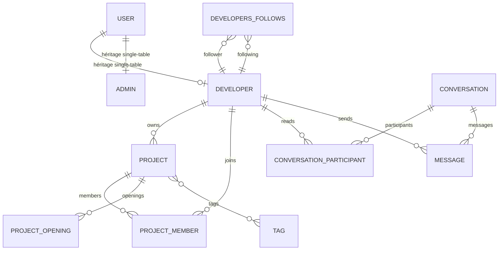

# Architecture de la base de données

## Système de gestion de données

Le backend utilise PostgreSQL comme base relationnelle principale. Elle est installée par le service `postgres` dans [docker-compose.yml](../../docker-compose.yml) et configurée dans [backend/src/main/resources/application.yaml](../../backend/src/main/resources/application.yaml).

Flyway gère maintenant le schéma avec [V1__initial_schema.sql](../../backend/src/main/resources/db/migration/V1__initial_schema.sql), migration initiale générée à partir des entités JPA et du schéma PostgreSQL 17 produit par l'application. `spring.jpa.hibernate.ddl-auto=validate` est utilisé par défaut et dans tous les profils : Hibernate vérifie le schéma après les migrations sans le modifier. Les migrations suivantes doivent être ajoutées avec des versions croissantes ; V1 ne doit plus être modifiée après déploiement.

Une base historique sans `flyway_schema_history` nécessite une baseline explicite en version 1 après sauvegarde et vérification de compatibilité avec V1. La baseline ne migre pas les tables ; Hibernate valide ensuite le schéma. L'index unique partiel des sprints ouverts est inclus dans V1 et reste vérifié par `DatabaseConstraints`.

## Stratégie de modélisation

L’application utilise JPA avec `@Entity`, des `@Table`, des `@Index`, des `@UniqueConstraint`, des `@CheckConstraint` et des relations `@ManyToOne`, `@ManyToMany`, `@OneToMany`, `@OneToOne`.

La base commune est [backend/src/main/java/com/hautetech/ndadiee/common/BaseEntity.java](../../backend/src/main/java/com/hautetech/ndadiee/common/BaseEntity.java), qui apporte `id`, `createdAt` et `updatedAt` à toutes les entités.

## Entités principales

### Utilisateurs

- [backend/src/main/java/com/hautetech/ndadiee/model/user/User.java](../../backend/src/main/java/com/hautetech/ndadiee/model/user/User.java)
- [backend/src/main/java/com/hautetech/ndadiee/model/user/Developer.java](../../backend/src/main/java/com/hautetech/ndadiee/model/user/Developer.java)
- [backend/src/main/java/com/hautetech/ndadiee/model/user/Admin.java](../../backend/src/main/java/com/hautetech/ndadiee/model/user/Admin.java)

Les comptes sont stockés dans une table unique `users` avec héritage `SINGLE_TABLE` et discriminateur `user_type`. Les contraintes de base imposent :

- username unique,
- email unique,
- rôle `USER`, `MODERATOR` ou `ADMIN` basé sur l’enum `Role`,
- les développeurs doivent avoir une `reputation` et un `open_to_work` non nulls quand `user_type = 'developer'`.

### Projets

- [backend/src/main/java/com/hautetech/ndadiee/model/project/Project.java](../../backend/src/main/java/com/hautetech/ndadiee/model/project/Project.java)
- [backend/src/main/java/com/hautetech/ndadiee/model/project/ProjectMember.java](../../backend/src/main/java/com/hautetech/ndadiee/model/project/ProjectMember.java)
- [backend/src/main/java/com/hautetech/ndadiee/model/project/ProjectOpening.java](../../backend/src/main/java/com/hautetech/ndadiee/model/project/ProjectOpening.java)

Les projets sont identifiés par `slug` unique. Un projet a un propriétaire `Developer`, une liste de `ProjectMember`, une liste de `ProjectOpening` et un ensemble de `Tag` via la table `project_tags`.

### Messagerie

- [backend/src/main/java/com/hautetech/ndadiee/model/message/Conversation.java](../../backend/src/main/java/com/hautetech/ndadiee/model/message/Conversation.java)
- [backend/src/main/java/com/hautetech/ndadiee/model/message/ConversationParticipant.java](../../backend/src/main/java/com/hautetech/ndadiee/model/message/ConversationParticipant.java)
- [backend/src/main/java/com/hautetech/ndadiee/model/message/Message.java](../../backend/src/main/java/com/hautetech/ndadiee/model/message/Message.java)

La conversation est identifiée par une `direct_key`, unique, calculée aux deux identifiants des participants. Chaque conversation garde son `last_message_at`. Les messages sont liés à une conversation et à un expéditeur, et ils permettent un soft-delete (`deleted_at`) tout en conservant la trace de l’emplacement.

### Contenus communautaires

- [backend/src/main/java/com/hautetech/ndadiee/model/content/Question.java](../../backend/src/main/java/com/hautetech/ndadiee/model/content/Question.java)
- [backend/src/main/java/com/hautetech/ndadiee/model/content/Article.java](../../backend/src/main/java/com/hautetech/ndadiee/model/content/Article.java)
- [backend/src/main/java/com/hautetech/ndadiee/model/content/Answer.java](../../backend/src/main/java/com/hautetech/ndadiee/model/content/Answer.java)
- [backend/src/main/java/com/hautetech/ndadiee/model/content/Tag.java](../../backend/src/main/java/com/hautetech/ndadiee/model/content/Tag.java)

Les contenus sont fortement liés aux profils et aux tags. Les questions et articles portent des métadonnées de publication, des votes et des commentaires. Le schéma est naturellement enrichi autour d’un modèle social / éditorial.

## Relations et cardinalités

- `Developer` est distinct de `User`, mais hérité en `SINGLE_TABLE` via le discriminateur `user_type`.
- `Project` a un seul `owner` (`ManyToOne` vers `Developer`).
- `Project` a plusieurs `ProjectMember` (`OneToMany`, cascade et orphan removal).
- `Project` a plusieurs `ProjectOpening` (`OneToMany`, cascade).
- `Project` a plusieurs `Tag` via `project_tags` (`ManyToMany`).
- `Conversation` a plusieurs `Message` et plusieurs `ConversationParticipant`.
- `Message` a un `Conversation` et un `sender` (`Developer`).
- `Developer` peut suivre d’autres développeurs via `user_follows`.
- `Developer` peut avoir des compétences et des tags suivis via les tables `user_skills` et `user_followed_tags`.

## Contraintes, index et héritage

Les points les plus visibles dans le code sont :

- `uk_users_username` et `uk_users_email` sur `users`,
- `uk_projects_slug` sur `projects`,
- `uk_conversations_direct_key` sur `conversations`,
- `uk_messages_sender_client` sur `messages` pour éviter les doublons de publication,
- `ck_users_type` et `ck_users_developer`,
- `ck_messages_body` pour garder un contrat sur les messages supprimés.

Les index sont présents sur les colonnes clés de tri et de filtrage : `country`, `reputation`, `created_at`, `last_message_at`, etc.

## Initialisation des données

La base est initialisée par le mécanisme de seeders. La configuration dans [backend/src/main/resources/application.yaml](../../backend/src/main/resources/application.yaml) montre `ndadiee.seed.enabled=true` et des comptes de démonstration avec mots de passe de développement. Ces données sont clairement destinées au développement, pas à la production.

## Risques identifiés

1. Une base existante ne doit pas être baselinée aveuglément : la métadonnée version 1 suppose que son schéma correspond à V1. Une comparaison et une sauvegarde vérifiées sont nécessaires avant la baseline.
2. La stratégie de données de démo (`seed`) est activée par défaut en local ; elle ne doit pas être diffusée comme une production réelle.
3. Les tableaux de jointure et les relations orientées `Set` peuvent produire des cycles métiers ou des suppressions partielles si elles ne sont pas strictement contrôlées par les services.
4. La table `User` en héritage `SINGLE_TABLE` est pratique, mais peut devenir lourde ou difficile à gérer si le système grandit.

## Diagramme ER représentatif

## Fichiers sources examinés

- [docker-compose.yml](../../docker-compose.yml)
- [backend/src/main/resources/application.yaml](../../backend/src/main/resources/application.yaml)
- [backend/src/main/java/com/hautetech/ndadiee/common/BaseEntity.java](../../backend/src/main/java/com/hautetech/ndadiee/common/BaseEntity.java)
- [backend/src/main/java/com/hautetech/ndadiee/model/user/User.java](../../backend/src/main/java/com/hautetech/ndadiee/model/user/User.java)
- [backend/src/main/java/com/hautetech/ndadiee/model/user/Developer.java](../../backend/src/main/java/com/hautetech/ndadiee/model/user/Developer.java)
- [backend/src/main/java/com/hautetech/ndadiee/model/project/Project.java](../../backend/src/main/java/com/hautetech/ndadiee/model/project/Project.java)
- [backend/src/main/java/com/hautetech/ndadiee/model/project/ProjectMember.java](../../backend/src/main/java/com/hautetech/ndadiee/model/project/ProjectMember.java)
- [backend/src/main/java/com/hautetech/ndadiee/model/message/Conversation.java](../../backend/src/main/java/com/hautetech/ndadiee/model/message/Conversation.java)
- [backend/src/main/java/com/hautetech/ndadiee/model/message/ConversationParticipant.java](../../backend/src/main/java/com/hautetech/ndadiee/model/message/ConversationParticipant.java)
- [backend/src/main/java/com/hautetech/ndadiee/model/message/Message.java](../../backend/src/main/java/com/hautetech/ndadiee/model/message/Message.java)

## Documentation associée

- [architecture-backend.md](architecture-backend.md)
- [architecture-frontend.md](architecture-frontend.md)
- [architecture-securite.md](architecture-securite.md)
- [architecture-websocket.md](architecture-websocket.md)
