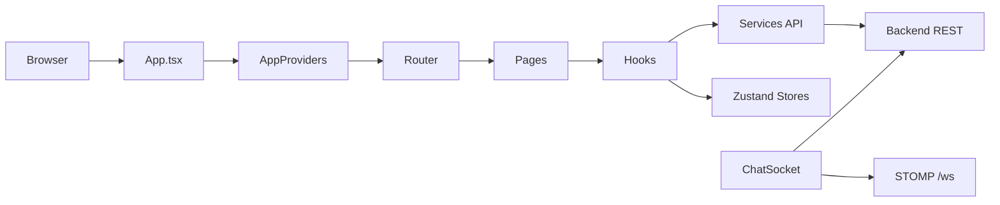

# Architecture frontend

## Vue d’ensemble

Le frontend est une application React 19 + TypeScript + Vite, avec un système de routage client, des requêtes HTTP via Axios, un cache React Query, un store Zustand pour l’état global et une couche d’i18n multi-langue. La configuration est lisible dans [frontend/package.json](../../frontend/package.json) et dans [frontend/src/App.tsx](../../frontend/src/App.tsx).

## Organisation des dossiers

Les dossiers du frontend sont cohérents avec une architecture orientée par domaines :

- `src/app` / `src/pages` : écrans applicatifs,
- `src/components` : composants réutilisables,
- `src/hooks` : hooks métier et hooks de session,
- `src/store` : état global (auth, chat, thème, etc.),
- `src/services` : clients API et logique d’accès distant,
- `src/lib` : utilitaires, cache, socket, objets de configuration,
- `src/router` : définition des routes et gardes d’accès,
- `src/types` : modèles TypeScript,
- `src/i18n` : fichiers de traduction.

## Architecture React

L’application est démarrée par [frontend/src/App.tsx](../../frontend/src/App.tsx), qui instancie `AppProviders` et `RouterProvider`.

Le point clé est l’usage de contextes et de store centralisés :

- `QueryClientProvider` pour la gestion du cache serveur,
- `Direction.Provider` pour la direction d’écriture (RTL/LTR),
- `MotionConfig` et `LazyMotion` pour les animations,
- `Toaster` pour les notifications,
- `useSessionSync()` pour synchroniser l’état de session et rafraîchir le profil utilisateur.

## Routage

Le routage est construit avec `createBrowserRouter` dans [frontend/src/router/index.tsx](../../frontend/src/router/index.tsx). La routeur organise les flux selon trois zones :

- visiteur public,
- authentifié (membre développeur),
- admin (back-office).

Les gardes d’accès sont codés dans :

- [frontend/src/router/ProtectedRoute.tsx](../../frontend/src/router/ProtectedRoute.tsx)
- [frontend/src/router/GuestRoute.tsx](../../frontend/src/router/GuestRoute.tsx)
- [frontend/src/router/AdminRoute.tsx](../../frontend/src/router/AdminRoute.tsx)

Le système redirige automatiquement vers `/login` si un visiteur tente d’entrer dans une page protégée. Un admin est renvoyé vers le back-office si sa session est de type admin.

## Pages et composants

Le front est conçu comme un produit multi-rôles :

- pages publiques : landing, showcase, forum, hackathons, profil, recherche,
- pages membres : dashboard, projets, workspaces, messages, notifications, settings,
- pages admin : gestion des contenus, utilisateurs, journal.

Les composants sont séparés entre UI générique et domaines métier (`profile`, `projects`, `forum`, `workspace`, `messages`, `reviews`, `hackathons`, `admin`, etc.). Le découpage est cohérent et suit les entités du backend.

## Hooks personnalisés

Les hooks exposent la logique de session et de données :

- [frontend/src/hooks/useAuth.ts](../../frontend/src/hooks/useAuth.ts) : session, login, logout, rôle et disponibilité du compte,
- [frontend/src/hooks/useDashboard.ts](../../frontend/src/hooks/useDashboard.ts) : données du tableau de bord,
- [frontend/src/hooks/useFeed.ts](../../frontend/src/hooks/useFeed.ts),
- [frontend/src/hooks/useComments.ts](../../frontend/src/hooks/useComments.ts),
- [frontend/src/hooks/useMessages.ts](../../frontend/src/hooks/useMessages.ts) (selon l’arborescence du dépôt).

Le front utilise React Query pour les états de requête, le cache et les invalidations après mutation.

## Services API

Les appels réseau passent par [frontend/src/services/api.ts](../../frontend/src/services/api.ts), qui configure :

- base URL,
- headers JSON,
- langue du navigateur,
- gestion des tokens JWT,
- rafraîchissement automatique du token,
- interception des erreurs 401/403.

Le rafraîchissement de session est centralisé : si l’access token expire, la requête est retravaillée avec un refresh token. La logique est robuste et évite les doublons de refresh concurrent.

## Gestion des états globaux

L’état global est partagé via Zustand :

- [frontend/src/store/useAuthStore.ts](../../frontend/src/store/useAuthStore.ts)
- [frontend/src/store/useChatStore.ts](../../frontend/src/store/useChatStore.ts)
- [frontend/src/store/useThemeStore.ts](../../frontend/src/store/useThemeStore.ts)

Les stores sont légers, orientés flux, et sont principalement utilisés pour l’authentification, la messagerie en temps réel et les préférences d’interface.

## Gestion de l’authentification

L’authentification côté client est traitée par :

- `useLogin()` et `useRegister()` dans [frontend/src/hooks/useAuth.ts](../../frontend/src/hooks/useAuth.ts),
- `authService` dans [frontend/src/services/auth.service.ts](../../frontend/src/services/auth.service.ts),
- `useAuthStore` dans [frontend/src/store/useAuthStore.ts](../../frontend/src/store/useAuthStore.ts),
- `storage` pour conserver le token et les infos utilisateur localement.

Le modèle de session est bien pensé : un access token et un refresh token sont stockés, l’utilisateur connecté est rechargé au démarrage, et la session est révoquée si le refresh échoue avec une erreur de blocage de compte.

## Gestion des erreurs et formulaires

Le front utilise les bibliothèques suivantes pour les formulaires :

- `react-hook-form`
- `@hookform/resolvers`
- `zod`

Cela permet une validation côté client avant envoi, plus des messages d’erreurs structurés. La combinaison avec les réponses HTTP du backend donne une UX cohérente et un retour immédiat sur les erreurs de saisie.

## Communication temps réel

La messagerie temps réel est basée sur STOMP + WebSocket, concrètement dans [frontend/src/lib/chatSocket.ts](../../frontend/src/lib/chatSocket.ts). Le code montre :

- une unique connexion WebSocket par application,
- renouvellement du JWT avant connexion si nécessaire,
- souscription à `/user/queue/chat`,
- envoi de signaux de saisie vers `/app/conversations/{id}/typing`.

Le front traite aussi les événements de reconnecte et applique les mises à jour au cache React Query.

## Diagramme de structure

## Points de vigilance

- le frontend suit une architecture moderne et lisible ;
- l’état global est bien découpé, même si la quantité de fichiers et de stores reste importante ;
- le système de routage est clair et défend bien les zones publiques / privées / admin ;
- le code montre des bonnes pratiques de robustesse côté session, mais il n’est pas possible de conclure à une couverture de tests front sans exécution réelle de la suite.

## Fichiers sources examinés

- [frontend/package.json](../../frontend/package.json)
- [frontend/src/App.tsx](../../frontend/src/App.tsx)
- [frontend/src/router/index.tsx](../../frontend/src/router/index.tsx)
- [frontend/src/router/ProtectedRoute.tsx](../../frontend/src/router/ProtectedRoute.tsx)
- [frontend/src/hooks/useAuth.ts](../../frontend/src/hooks/useAuth.ts)
- [frontend/src/services/api.ts](../../frontend/src/services/api.ts)
- [frontend/src/lib/chatSocket.ts](../../frontend/src/lib/chatSocket.ts)
- [frontend/src/store/useAuthStore.ts](../../frontend/src/store/useAuthStore.ts)

## Documentation associée

- [architecture-backend.md](architecture-backend.md)
- [architecture-base-de-donnees.md](architecture-base-de-donnees.md)
- [architecture-securite.md](architecture-securite.md)
- [architecture-websocket.md](architecture-websocket.md)
