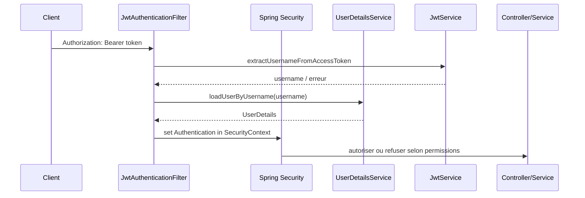

# Architecture de sécurité

## Vue d’ensemble

Le backend s’appuie sur Spring Security, sur un mécanisme JWT stateless, sur des permissions cataloguées et sur des règles HTTP spécifiques appliquées à chaque endpoint. La configuration principale est dans [backend/src/main/java/com/hautetech/ndadiee/security/SecurityConfiguration.java](../../backend/src/main/java/com/hautetech/ndadiee/security/SecurityConfiguration.java), avec l’implémentation des filtres et du service JWT dans [backend/src/main/java/com/hautetech/ndadiee/security/JwtAuthenticationFilter.java](../../backend/src/main/java/com/hautetech/ndadiee/security/JwtAuthenticationFilter.java) et [backend/src/main/java/com/hautetech/ndadiee/security/JwtService.java](../../backend/src/main/java/com/hautetech/ndadiee/security/JwtService.java).

## Authentification

### UserDetailsService

[backend/src/main/java/com/hautetech/ndadiee/security/ApplicationConfig.java](../../backend/src/main/java/com/hautetech/ndadiee/security/ApplicationConfig.java) configure le `UserDetailsService` pour identifier l’utilisateur via son email ou son nom d’utilisateur, puis `BCryptPasswordEncoder` comme encodeur de mot de passe.

### JWT

Le service JWT :

- émet des `access tokens` et `refresh tokens`,
- distingue les tokens via le claim `type`,
- vérifie signature, date d’expiration et type attendu,
- ne stocke pas l’état côté serveur.

Les durées sont configurées dans [backend/src/main/resources/application.yaml](../../backend/src/main/resources/application.yaml) :

- access-token-expiration : `30m`,
- refresh-token-expiration : `30d`.

Le secret est également documenté dans ce fichier avec une valeur de développement. Il ne doit pas être exposé dans de la documentation de production et doit être remplacé par une vraie valeur secrète dans un environnement réel.

## Filtres et flux d’authentification

`JwtAuthenticationFilter` s’exécute sur chaque requête HTTP. Il :

- lit le header `Authorization` au format `Bearer ...`,
- valide le token via `JwtService`,
- charge l’utilisateur correspondant,
- remplit le `SecurityContextHolder` si le compte n’est pas suspendu,
- laisse la requête continuer sans blocage si le token est mal formé ou expiré.

Ce comportement est intentionnel : il permet au front de tenter un rafraîchissement de session en cas de 401, sans casser la navigation publique.

## Autorisations

Les permissions sont définies dans [backend/src/main/java/com/hautetech/ndadiee/model/user/Permission.java](../../backend/src/main/java/com/hautetech/ndadiee/model/user/Permission.java) ; les rôles dans [backend/src/main/java/com/hautetech/ndadiee/model/user/Role.java](../../backend/src/main/java/com/hautetech/ndadiee/model/user/Role.java).

L’API applique des règles par URL dans `SecurityConfiguration`, dont les grandes familles sont :

- endpoints publics,
- endpoints d’authentification,
- endpoints privés de contenu communautaire,
- endpoints écriture (POST / PUT / PATCH / DELETE),
- accès admin sur `/v1/admin/**`.

La configuration contient aussi des règles spécifiques pour :

- `/media/**` et `/uploads/**` publics,
- `/ws` et `/ws/**` publics sur la poignée de main,
- `/swagger-ui` et `/v3/api-docs` publics,
- au moins une partie du contenu communautaire en lecture ouverte.

## CORS et politique de réseau

Dans `SecurityConfiguration`, la configuration CORS autorise :

- le domaine `frontend.url`,
- les ports `localhost:*` en développement,
- tous les headers,
- tous les méthodes,
- l’en-tête `Authorization` exposé.

La base API est aussi déclarée stateless via `SessionCreationPolicy.STATELESS`, ce qui évite le stockage de sessions côté serveur.

## Contrôle d’accès aux ressources

La règle globale est simple :

- les endpoints publics sont autorisés,
- le reste exige une authentification,
- les règles d’autorisation les plus fines sont vérifiées dans les services et au niveau des méthodes Spring (`@PreAuthorize` est activé par `@EnableMethodSecurity`).

Il y a donc une couche d’accès par URL, complétée par un contrôle métier sur les objets et contenus. C’est conforme à une architecture de sécurité plus robuste qu’un simple `permitAll()` / `authenticated()`.

## Gestion des secrets et de la production

Les variables clés sont dans [backend/src/main/resources/application.yaml](../../backend/src/main/resources/application.yaml). Le fichier montre :

- `jwt.secret` en base64,
- `R2` credentials,
- `GITHUB_TOKEN`,
- `MAIL_FROM` / SMTP context,
- paramètres de stockage.

Le projet ne révèle pas les vraies valeurs dans le dépôt, mais la configuration montre bien qu’il existe une séparation entre le mode local et le mode de production. Le seul point important : la documentation ne doit pas divulguer de secret réel, et la valeur par défaut du secret JWT est clairement explicitement de type développement.

## Risques identifiés

- `JWT_SECRET` est obligatoire, sans valeur de repli ; une clé absente, invalide ou inférieure à 256 bits fait échouer le démarrage.
- Les règles de sécurité combinent contrôles HTTP et contrôles métier, ce qui est bien, mais exige une vigilance sur les exceptions de permission et sur la cohérence des services.
- L’application ouvre certaines routes publiques en lecture ; cela est documenté dans la configuration, mais cela doit être confirmé vis-à-vis des besoins métier.
- La gestion des comptes suspendus est présente, mais la logique de refus est surtout implémentée dans les services et filtres — il convient de ne pas la considérer comme un mécanisme de sécurité autonome sans revue plus fine.

## Diagramme de sécurité

## Fichiers sources examinés

- [backend/src/main/resources/application.yaml](../../backend/src/main/resources/application.yaml)
- [backend/src/main/java/com/hautetech/ndadiee/security/SecurityConfiguration.java](../../backend/src/main/java/com/hautetech/ndadiee/security/SecurityConfiguration.java)
- [backend/src/main/java/com/hautetech/ndadiee/security/ApplicationConfig.java](../../backend/src/main/java/com/hautetech/ndadiee/security/ApplicationConfig.java)
- [backend/src/main/java/com/hautetech/ndadiee/security/JwtAuthenticationFilter.java](../../backend/src/main/java/com/hautetech/ndadiee/security/JwtAuthenticationFilter.java)
- [backend/src/main/java/com/hautetech/ndadiee/security/JwtService.java](../../backend/src/main/java/com/hautetech/ndadiee/security/JwtService.java)
- [backend/src/main/java/com/hautetech/ndadiee/model/user/Role.java](../../backend/src/main/java/com/hautetech/ndadiee/model/user/Role.java)
- [backend/src/main/java/com/hautetech/ndadiee/model/user/Permission.java](../../backend/src/main/java/com/hautetech/ndadiee/model/user/Permission.java)
- [backend/src/main/java/com/hautetech/ndadiee/exception/GlobalExceptionHandler.java](../../backend/src/main/java/com/hautetech/ndadiee/exception/GlobalExceptionHandler.java)

## Documentation associée

- [architecture-backend.md](architecture-backend.md)
- [architecture-websocket.md](architecture-websocket.md)
- [integrations-externes.md](integrations-externes.md)
