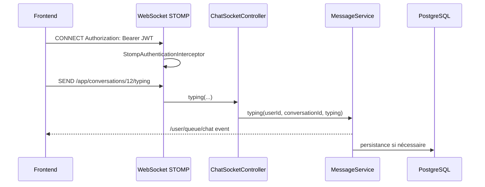

# Architecture WebSocket

## Vue d’ensemble

La messagerie en temps réel de Ndadiée repose sur Spring WebSocket + STOMP. La configuration est dans [backend/src/main/java/com/hautetech/ndadiee/config/WebSocketConfig.java](../../backend/src/main/java/com/hautetech/ndadiee/config/WebSocketConfig.java), la couche de sécurisation dans [backend/src/main/java/com/hautetech/ndadiee/security/StompAuthenticationInterceptor.java](../../backend/src/main/java/com/hautetech/ndadiee/security/StompAuthenticationInterceptor.java), et le contrôleur de messages dans [backend/src/main/java/com/hautetech/ndadiee/controller/ChatSocketController.java](../../backend/src/main/java/com/hautetech/ndadiee/controller/ChatSocketController.java).

La configuration établit :

- endpoint STOMP : `/ws`,
- prefixe applicatif : `/app`,
- prefixe utilisateur : `/user`,
- broker simple : `/queue`,
- heartbeat dans les deux sens.

## Endpoint et transport

`WebSocketConfig.registerStompEndpoints()` ajoute l’endpoint `/ws` avec `setAllowedOriginPatterns(frontendUrl, "http://localhost:*")`. Le front construit le broker URL en fonction de l’adresse de l’API, avec conversion `https` vers `wss` et `http` vers `ws`.

Le transport WebSocket est contenu à une taille de message raisonnable : `16 KB`, buffer de `512 KB`, délai d’envoi de 15 secondes.

## Authentification WebSocket

La sécurité STOMP est renforcée par `StompAuthenticationInterceptor`.

Règles observées :

- sur `CONNECT`, le JWT est extrait de l’en-tête `Authorization` de la trame STOMP ;
- le membre doit être un `Developer`, non suspendu ;
- sur `SUBSCRIBE`, la destination doit commencer par `/user/queue/` ;
- sur `SEND`, la destination doit commencer par `/app/` ;
- toute tentative vers une destination non autorisée est rejetée avec un message `UNAUTHORIZED` ou `FORBIDDEN_DESTINATION`.

L’authentification WebSocket est donc stricte et ne laisse pas un client abuser des files privées d’autres membres.

## Flux de communication

### Envoi du signal “en train d’écrire”

Le front publie un message vers `/app/conversations/{conversationId}/typing` : cela est visible dans [frontend/src/lib/chatSocket.ts](../../frontend/src/lib/chatSocket.ts).

Le backend reçoit ce message dans `ChatSocketController.typing()`.

### Export des notifications vers le client

Le service de messagerie envoie ensuite les événements sur le flux privé utilisateur via `convertAndSendToUser(userId.toString(), "/queue/chat", payload)`. Cela correspond à l’architecture du broker simple en mémoire, où chaque membre reçoit ses événements sur sa propre file.

## Messages et événements

Le backend et le frontend conservent une logique claire :

- le message est validé et enregistré par l’API REST,
- l’événement de chat est ensuite publié vers le membre concerné,
- le front écoute `/user/queue/chat` pour mettre à jour le cache et l’UI.

Cette séparation est cohérente avec la robustesse : le server garde le “vrai” message dans la base, tandis que le WebSocket ne sert qu’à la diffusion en temps réel et aux signaux transitoires.

## Points de vigilance

- le système repose sur un broker mémoire simple, ce qui est adapté à un seul nœud ;
- la documentation dans le code précise qu’un relais externe (`RabbitMQ` / `ActiveMQ`) serait nécessaire pour une architecture multi-instance ;
- la connexion est robuste au réseau avec heartbeat et tentatives de reconnexion exponentielles.

## Diagramme

## Fichiers sources examinés

- [backend/src/main/java/com/hautetech/ndadiee/config/WebSocketConfig.java](../../backend/src/main/java/com/hautetech/ndadiee/config/WebSocketConfig.java)
- [backend/src/main/java/com/hautetech/ndadiee/security/StompAuthenticationInterceptor.java](../../backend/src/main/java/com/hautetech/ndadiee/security/StompAuthenticationInterceptor.java)
- [backend/src/main/java/com/hautetech/ndadiee/controller/ChatSocketController.java](../../backend/src/main/java/com/hautetech/ndadiee/controller/ChatSocketController.java)
- [backend/src/main/java/com/hautetech/ndadiee/service/message/ChatNotifier.java](../../backend/src/main/java/com/hautetech/ndadiee/service/message/ChatNotifier.java)
- [frontend/src/lib/chatSocket.ts](../../frontend/src/lib/chatSocket.ts)

## Documentation associée

- [architecture-backend.md](architecture-backend.md)
- [architecture-securite.md](architecture-securite.md)
- [architecture-frontend.md](architecture-frontend.md)
