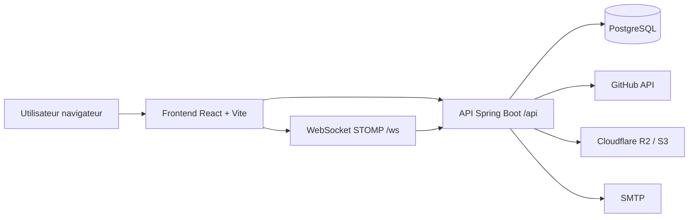
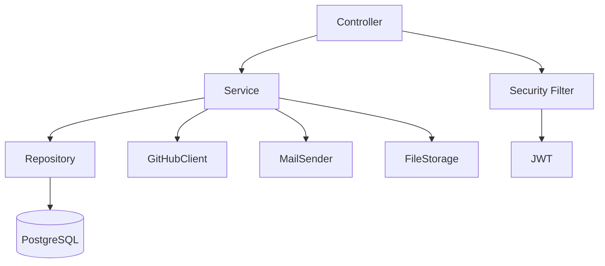
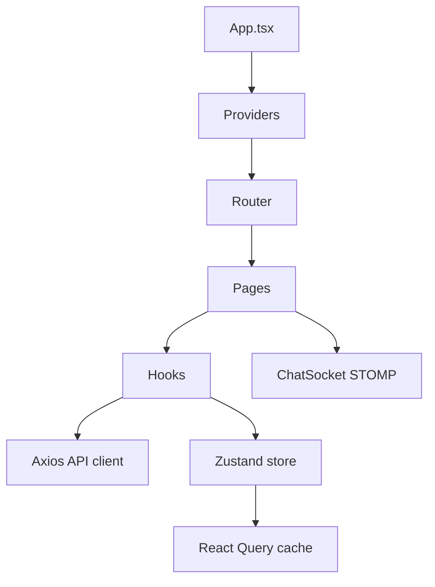
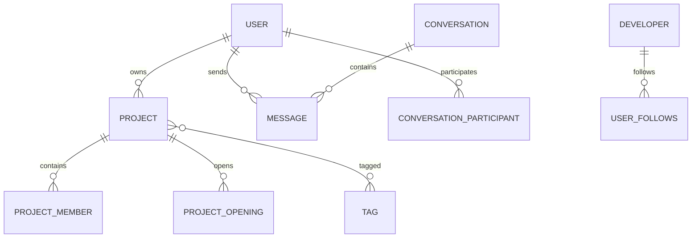
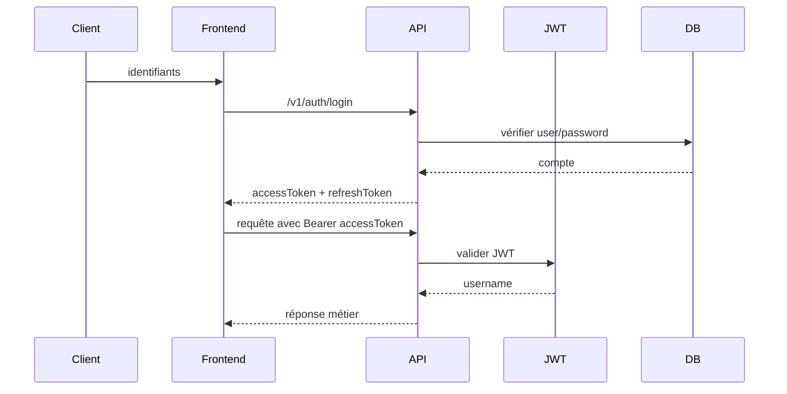
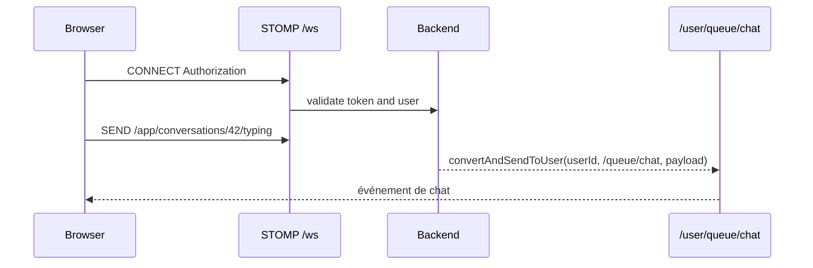
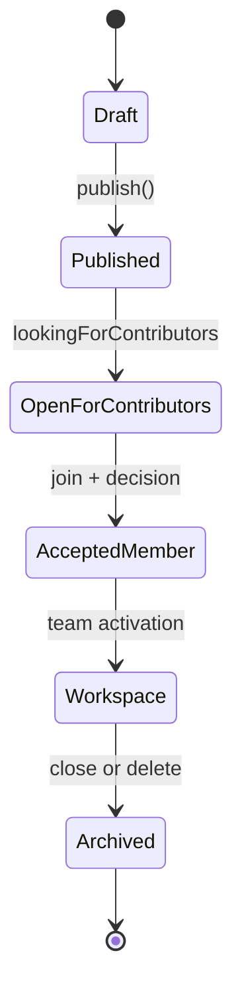
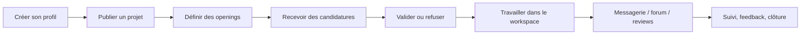

# Diagrammes d’architecture

## 1. Architecture globale

## 2. Architecture backend

## 3. Architecture frontend

## 4. Modèle de données principal

## 5. Authentification

## 6. Communication WebSocket

## 7. Cycle de vie d’un projet

## 8. Parcours de collaboration

## Observations

- Les diagrammes ci-dessus se basent sur les classes et config réellement observées dans le dépôt ;
- ils reflètent des mécanismes existants, pas des schémas hypothétiques ;
- les éléments de production non vérifiés restent à confirmer dans l’environnement réel.

## Fichiers sources examinés

- [backend/src/main/java/com/hautetech/ndadiee/config/WebSocketConfig.java](../../backend/src/main/java/com/hautetech/ndadiee/config/WebSocketConfig.java)
- [backend/src/main/java/com/hautetech/ndadiee/security/SecurityConfiguration.java](../../backend/src/main/java/com/hautetech/ndadiee/security/SecurityConfiguration.java)
- [backend/src/main/java/com/hautetech/ndadiee/model/project/Project.java](../../backend/src/main/java/com/hautetech/ndadiee/model/project/Project.java)
- [backend/src/main/java/com/hautetech/ndadiee/model/user/Developer.java](../../backend/src/main/java/com/hautetech/ndadiee/model/user/Developer.java)
- [backend/src/main/java/com/hautetech/ndadiee/model/message/Conversation.java](../../backend/src/main/java/com/hautetech/ndadiee/model/message/Conversation.java)
- [frontend/src/router/index.tsx](../../frontend/src/router/index.tsx)
- [frontend/src/lib/chatSocket.ts](../../frontend/src/lib/chatSocket.ts)

## Documentation associée

- [architecture-backend.md](architecture-backend.md)
- [architecture-frontend.md](architecture-frontend.md)
- [architecture-base-de-donnees.md](architecture-base-de-donnees.md)
- [architecture-securite.md](architecture-securite.md)
- [architecture-websocket.md](architecture-websocket.md)
- [integrations-externes.md](integrations-externes.md)
