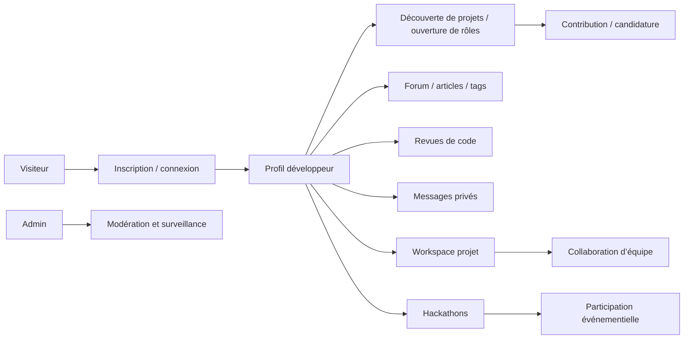

# Documentation fonctionnelle de Ndadiée

Ce dossier centralise la description fonctionnelle de la plateforme en s’appuyant sur les contrôleurs, services, DTO et écrans frontend réellement présents dans le dépôt. La vocation est de distinguer les fonctionnalités vérifiables de celles qui restent à confirmer ou à compléter avant mise en production.

## Statut global

| Domaine | Statut | Évidence principale |
|---|---|---|
| Authentification | Implémenté | `backend/src/main/java/com/hautetech/ndadiee/authentication/AuthenticationController.java` |
| Profils utilisateur | Implémenté | `backend/src/main/java/com/hautetech/ndadiee/controller/UserController.java` |
| Projets | Implémenté | `backend/src/main/java/com/hautetech/ndadiee/controller/ProjectController.java` |
| Collaboration / workspace | Implémenté | `backend/src/main/java/com/hautetech/ndadiee/controller/WorkspaceController.java` |
| Communauté / forum | Implémenté | `backend/src/main/java/com/hautetech/ndadiee/controller/QuestionController.java` et `ArticleController.java` |
| Revues de code | Implémenté | `backend/src/main/java/com/hautetech/ndadiee/controller/ReviewController.java` et `PullRequestController.java` |
| Hackathons | Implémenté | `backend/src/main/java/com/hautetech/ndadiee/controller/HackathonController.java` |
| Messagerie privée | Implémenté | `backend/src/main/java/com/hautetech/ndadiee/controller/ConversationController.java` |
| Administration | Implémenté | `backend/src/main/java/com/hautetech/ndadiee/controller/AdminController.java` |
| Notifications | Implémenté | `backend/src/main/java/com/hautetech/ndadiee/controller/NotificationController.java` |
| Recherche | Implémenté | `backend/src/main/java/com/hautetech/ndadiee/controller/SearchController.java` |
| GitHub | Partiellement implémenté | `backend/src/main/java/com/hautetech/ndadiee/controller/GithubController.java` |

## Plan de lecture

- [authentification.md](authentification.md)
- [profils-utilisateurs.md](profils-utilisateurs.md)
- [projets.md](projets.md)
- [collaboration.md](collaboration.md)
- [communaute.md](communaute.md)
- [revue-de-code.md](revue-de-code.md)
- [hackathons.md](hackathons.md)
- [messagerie.md](messagerie.md)
- [administration.md](administration.md)
- [notifications.md](notifications.md)
- [recherche.md](recherche.md)
- [github.md](github.md)

## Principes de vérification

- Toutes les descriptions ci-dessous sont soutenues par des chemins de fichiers du dépôt.
- Les fonctionnalités sont classées selon le statut requis : Implémenté, Partiellement implémenté, Non implémenté ou Non vérifié.
- Les éléments de production, de conformité ou de déploiement restent signalés comme à confirmer par l’équipe.

## Vue d’ensemble du parcours utilisateur

## Fichiers associés

- [../README.md](../README.md)
- [../matrice-fonctionnalites.md](../matrice-fonctionnalites.md)
