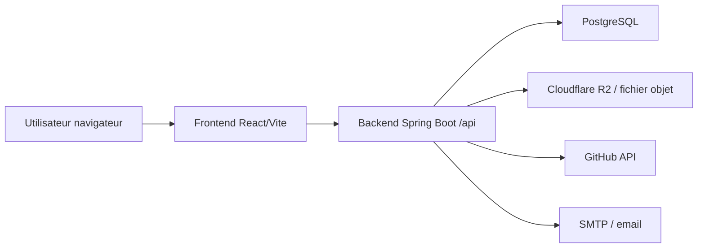
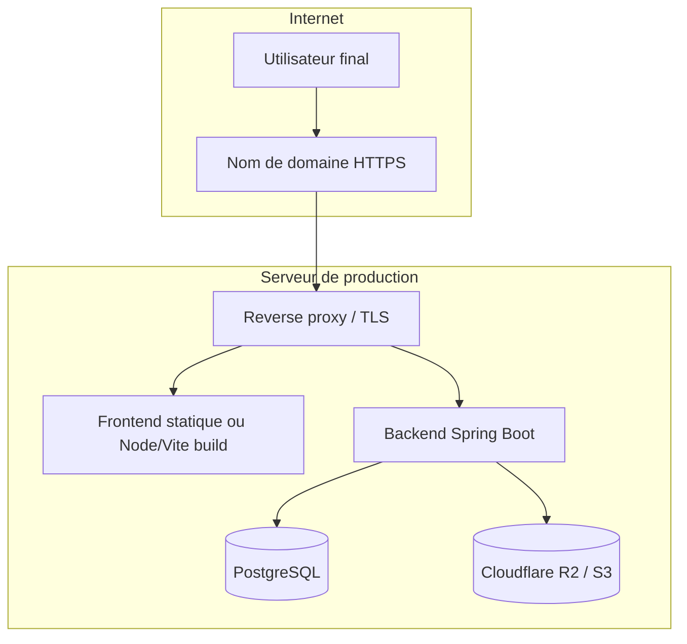

# Architecture de déploiement

Cette section décrit l’architecture de production raisonnable pour Ndadiée, basée sur le code réel observé et sur la configuration disponible. Elle ne prétend pas démontrer un déploiement existant.

## 1. Architecture globale observée

Le dépôt fournit un environnement de développement orienté conteneur pour PostgreSQL, alors que le backend et le frontend peuvent être lancés directement sur la machine de développement.

## 2. Composants réels du dépôt

### Frontend

- Vue locale sur `http://localhost:5173`.
- Paramétré via [frontend/src/utils/constants.ts](../../frontend/src/utils/constants.ts).
- Utilise `VITE_BACKEND_URL` pour pointer vers le backend.

### Backend

- Sert sur `http://localhost:8080` avec contexte `/api`.
- Configuré dans [backend/src/main/resources/application.yaml](../../backend/src/main/resources/application.yaml).
- Sécurisé par Spring Security et JWT.

### Base de données

- Service `postgres` défini dans [docker-compose.yml](../../docker-compose.yml).
- Port local exposé : `5434` sur l’hôte.

### Stockage externe

- Configuration R2/S3 dans [.env.example](../../.env.example).
- Variables : `R2_ACCOUNT_ID`, `R2_ACCESS_KEY_ID`, `R2_SECRET_ACCESS_KEY`, `R2_BUCKET`, `R2_PUBLIC_URL`.

## 3. Architecture proposée en production

## 4. Points à sécuriser

- `JWT_SECRET` doit être unique et forte.
- `FRONTEND_URL` doit correspondre au domaine public exact.
- Les ports basés sur l’hôte local doivent être fermés à l’extérieur.
- Les secrets de Cloudflare R2 / GitHub / SMTP ne doivent pas être intégrés au dépôt.

## 5. Éléments manquants dans le dépôt

- aucun `Dockerfile` dédié au backend ou au frontend,
- aucune configuration Traefik/Nginx/SSL automatisée,
- aucune preuve de pipeline CI/CD,
- aucune URL publique ou environnement Datacloud déclaré dans le dépôt.

## 6. Recommandation

Pour une mise en production fiable, utiliser :

- un plan de déploiement avec services distincts pour le backend et le frontend,
- un réseau interne restreint entre le backend et la base,
- un proxy public uniquement sur le frontend et le backend via API publique sécurisée,
- un gestionnaire externe de secrets (par exemple Vault ou le gestionnaire de secrets de la plateforme cloud retenue).

## Sources

- [docker-compose.yml](../../docker-compose.yml)
- [backend/src/main/resources/application.yaml](../../backend/src/main/resources/application.yaml)
- [.env.example](../../.env.example)
- [frontend/src/utils/constants.ts](../../frontend/src/utils/constants.ts)
- [backend/src/main/java/com/hautetech/ndadiee/security/SecurityConfiguration.java](../../backend/src/main/java/com/hautetech/ndadiee/security/SecurityConfiguration.java)
