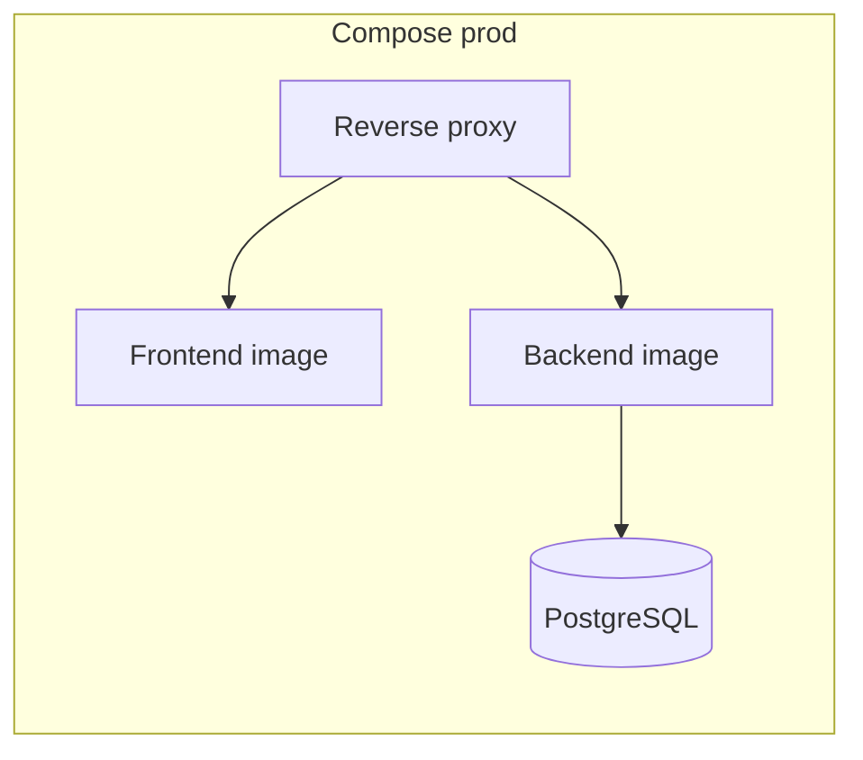

# Docker

Le dépôt contient un fichier [docker-compose.yml](../../docker-compose.yml), mais aucun Dockerfile backend ni frontend n’a été trouvé dans l’arborescence examinée.

## 1. Ce qui existe réellement

Le fichier docker-compose contient un service PostgreSQL nommé `postgres` :

- image : `postgres:17`
- conteneur : `postgres_ndadiee_container`
- port exposé : `127.0.0.1:${DB_PORT:-5434}:5432`
- volume : `postgres_data`
- healthcheck : `pg_isready`

Les noms de variables sont :

- `DB_NAME`
- `DB_USER`
- `DB_PASSWORD` (valeur par défaut de développement non reproduite ici)
- `DB_PORT`

Les valeurs de développement du Compose ne doivent jamais être réutilisées sur un environnement partagé ou de production.

## 2. Ce qui manque pour un déploiement complet

Pour un environnement de production, le dépôt ne fournit pas :

- Dockerfile pour le backend,
- Dockerfile pour le frontend,
- réseau multi-service défini pour backend + frontend + DB + proxy,
- healthchecks applicatifs,
- configuration de reverse proxy,
- pipeline d’image et de publication.

## 3. Architecture Docker recommandée



## 4. Commandes utilitaires

### Démarrer la base locale

```bash
docker compose up -d postgres
```

### Vérifier le conteneur

```bash
docker compose ps
docker compose logs postgres
```

### Arrêter le conteneur

```bash
docker compose down
```

### Réinitialiser complètement la base

```bash
docker compose down -v
```

> **Destructif :** `-v` supprime le volume PostgreSQL du projet et toutes les données qu’il contient. Ne pas exécuter cette commande sur une base contenant des données à conserver ; vérifier le contexte et les sauvegardes avant toute réinitialisation.

## 5. Recommandation de production

- découper chaque service dans un fichier spécifique ou un `compose.prod.yml`,
- définir des images construites à partir d’un Dockerfile dédié,
- stocker les secrets dans un environnement externe,
- utiliser l’option `restart: unless-stopped` et des healthchecks adaptés,
- éviter de publier des mots de passe de développement dans un environnement partagé.

## Sources

- [docker-compose.yml](../../docker-compose.yml)
- [.env.example](../../.env.example)
