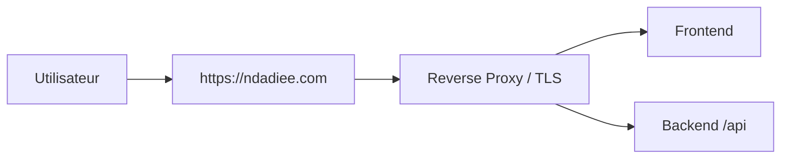

# Nom de domaine et HTTPS

L’équipe déclare avoir acheté le domaine `ndadiee.com` et indique que le site est accessible à [https://ndadiee.com/](https://ndadiee.com/). Le dépôt ne contient toutefois pas de configuration TLS ou de preuve de certificat ; il faut vérifier l’accès et le certificat depuis un navigateur externe avant d’affirmer que HTTPS fonctionne.

## 1. Paramètres observés

Le backend déclare :

- `FRONTEND_URL=http://localhost:5173` dans [.env.example](../../.env.example)

Le frontend construit son adresse API à partir de :

- [frontend/src/utils/constants.ts](../../frontend/src/utils/constants.ts)

```ts
export const API_BASE_URL = import.meta.env.VITE_BACKEND_URL ?? 'http://localhost:8080/api';
```

## 2. Configuration de production attendue

Pour une production sécurisée :

- utiliser le domaine déclaré `ndadiee.com` ou des sous-domaines documentés pour l’API,
- rediriger le trafic HTTP vers HTTPS,
- utiliser un certificat TLS valide,
- configurer le front et l’API derrière le même nom de domaine ou via sous-domaines séparés,
- sécuriser les cookies et les tokens s’ils sont utilisés côté navigateur.

## 3. Bonnes pratiques

- ne pas laisser l’API ou le frontend sur `http` en production,
- ne pas exposer le port 8080 directement si un reverse proxy tient déjà la TLS,
- utiliser des règles de redirection propres,
- mettre en place le renouvellement automatique du certificat.

## 4. Architecture recommandée



## 5. Preuves à collecter

- URL publique valide,
- certificat HTTPS actif,
- redirection HTTP → HTTPS,
- absence d’avertissement de sécurité navigateur,
- test sur navigateur réel avec la vraie URL.

URL déclarée par l’équipe : [https://ndadiee.com/](https://ndadiee.com/). Les contrôles de certificat, de redirection et d’accès réseau restent à exécuter et à dater.

## Sources

- [.env.example](../../.env.example)
- [frontend/src/utils/constants.ts](../../frontend/src/utils/constants.ts)
- [backend/src/main/resources/application.yaml](../../backend/src/main/resources/application.yaml)
